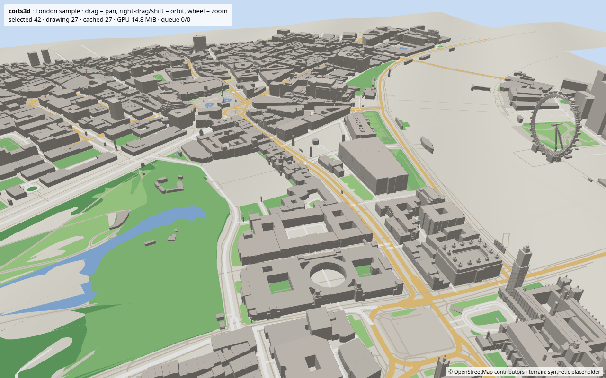

# coits3d: CoitsMoves 3D map

The foundation of HeyCoits' own 3D map for the CoitsMoves app. It is built from basics: our own tile format, loader, level-of-detail selection and a plain WebGL2 renderer, with no map SDK required.

> **Status:** early foundation. **Everything is behind feature flags, all off by default, and nothing is deployed.**
> Licence: [MIT](./LICENSE) © 2026 HeyCoits. Map data © OpenStreetMap contributors (ODbL).



## Quick start
```bash
npm ci
npm test                 # unit tests (node:test)
npm run typecheck
npm run demo             # builds London sample tiles (needs `osmium` CLI) + serves http://127.0.0.1:8765/demo/
```
Demo controls: drag to pan, right-drag or shift-drag to orbit/tilt, wheel to zoom.

## Architecture
```
 OSM .pbf / GeoJSON ──► builder/build.ts ──► {z}/{x}/{y}.c3dt  (or PMTiles)
                                                   │
         TileSource (HTTP | Directory | PMTiles | Memory)
                                                   │
 Camera ─► selectTiles (frustum + SSE LOD) ─► TileLoader (priority queue · cancel · retry · LRU)
                 │                                  │ decodeTile
                 └─► resolveRenderable (parent fallback) ─► TileRenderer (WebGL2, per-tile GPU buffers)
```

| Module | Path | What it does |
|---|---|---|
| Addressing | `src/tile/address.ts` | z/x/y XYZ quadtree (Web Mercator), lng/lat↔mercator, bounds, parent/children/ancestor, quadkey, neighbours |
| Tile format | `src/tile/format.ts` | `.c3dt` binary v1: header + typed layer sections; terrain grid, buildings (footprint + height/min height), roads, areas, imagery, spectrum aggregates, robot/business placeholders. Unknown layers are skipped for forward compatibility. |
| Sources | `src/loader/sources.ts` | `TileSource` interface: `HttpSource`, `DirectorySource`, `PMTilesSource` (adapter for the `pmtiles` package), `MemorySource` |
| Loader | `src/loader/loader.ts`, `lru.ts`, `queue.ts` | distance-priority heap, concurrency limit, AbortController cancellation of unwanted tiles, exponential-backoff retries, byte-bounded LRU with `onEvict` (frees GPU) and pinning |
| Selection | `src/select/*` | tilted orbit camera (local metric frame for float32 precision), frustum culling (AABB with terrain height range), screen-space-error LOD, parent/child fallback |
| Rendering | `src/render/*` | CPU mesh building (terrain grid with normals and UVs, earcut roofs plus extruded walls, draped road strips and area polygons), WebGL2 renderer with a VAO/VBO/IBO per tile, `disposeTile`, imagery draped on terrain |
| Builder | `builder/build.ts` | OSM `.pbf` (through `osmium export`) or GeoJSON → tiles z14–16, clipping roads per tile. Drops names/addresses. |
| Flags | `src/flags.ts` | `renderer3d`, `imagery`, `spectrumIngest`, `spectrumPublish`, `robotLayer`, `businessLayer`, `botApi`, all `false` |

### Tile format (`.c3dt` v1)
Little-endian. Header: `"C3DT"`, `u16 version`, `u8 z`, `u32 x`, `u32 y`, `u16 extent (4096)`, `u16 layerCount`. Each layer is `u8 type`, `u32 byteLength`, then the payload. Geometry uses tile-local integer coordinates (i16, so it can sit slightly outside the tile). Heights are in metres. Terrain is an N×N float32 grid whose edge samples are shared with neighbouring tiles. Version bumps must stay backward-readable.

### Rendering inside MapLibre (optional)
`TileRenderer.render(camera, ids, { clear: false })` only needs a WebGL2 context and a view-projection matrix, so it can be wrapped in a MapLibre `CustomLayerInterface` (`onAdd` creates the renderer on the map's `gl`, `render` builds the camera matrix from the map transform). Not wired yet.

## Data layers and roadmap (in order)
1. **Tile core** ✅ (this repo): addressing, format, loader, selection, renderer, builder, demo.
2. **People-sourced "spectrum data collection"** 🟡 *first data layer, in progress* (`src/spectrum/`): opt-in contributions from people out on roads, streets and parks. Covers anonymised GPS traces, surface/condition, park paths and phone sensor/signal readings (e.g. mobile signal dBm), aggregated per tile into the `Spectrum` layer. Done so far: types, sanitiser, ingest endpoint **stub**, aggregator and tests. Next: client SDK, persistent store (PostGIS), scheduled aggregation into tiles.
3. **Robot / AV delivery layer** ⏳ *placeholder* (`src/robot/`): walkable/drivable pavements, kerbs, crossings, slopes from terrain, obstacles and no-go zones, drop/loading points for verified businesses, and a cross-tile graph for path planning. Robot/AV connectors come after this.
4. **Business features** ⏳ *placeholder* (`src/business/`): verified registered businesses only (id, location, delivery points) plus the `queryBusinesses` API.

Also present: a **satellite imagery** hook (`src/imagery/source.ts`), a pluggable per-tile JPEG/WebP raster draped on the terrain. Only public-domain or open sources are allowed (e.g. NASA/USGS Landsat, Copernicus Sentinel-2). Google/Apple/Bing hosts are refused. There is also a read-only **bot query API**, documented in [docs/bot-api.md](docs/bot-api.md) with a JSON schema.

## Privacy (UK GDPR)
- Tiles carry no personal data. The builder keeps only geometry, height and class, and drops names, `addr:*`, phone numbers and the like.
- Spectrum contributions require `consent: true` and a `consentVersion` every time. They are rebuilt from an allow-list, so user/device ids, emails and similar fields are never stored. Timestamps are coarsened to the UTC day. The first and last 200 m of each trace are trimmed (home protection). Cells are published only with ≥ 5 contributors. Data is purged after 90 days. All of these thresholds are set in `DEFAULT_POLICY`.
- Businesses must be verified and registered. Home addresses are never included.

## Deploying later
Planned AWS layout (S3 eu-west-2 + CloudFront for tiles, Lambda or ECS Fargate for the API, Aurora PostgreSQL + PostGIS for data): see [docs/deploy-aws.md](docs/deploy-aws.md). Any static host or CDN can serve the `{z}/{x}/{y}.c3dt` files. The demo bundle is a static `demo/` folder.

## Known gaps
- Terrain is a **synthetic placeholder**. The next step is a real open DEM (Environment Agency LIDAR, OGL; or Copernicus GLO-30).
- The builder assigns polygons to tiles by centroid (no polygon clipping), so very large polygons (e.g. the Thames riverbank multipolygon) are skipped. Mesh building runs on the main thread (no worker yet), and there are no skirts or crack-fixing between LODs.
- `PMTilesSource` is an adapter only (no archive writer). Imagery tiles are not produced by the builder yet.
- The spectrum "contributor" count is per contribution, because no ids are held. Edge or device rate-limiting is needed to make k-anonymity robust.
- No MapLibre adapter or picking yet.

## Contributing
See [CONTRIBUTING.md](CONTRIBUTING.md) and our [Code of Conduct](CODE_OF_CONDUCT.md). Issues and PRs use the templates in `.github/`. CI runs typecheck and tests on Node 20 and 22.
